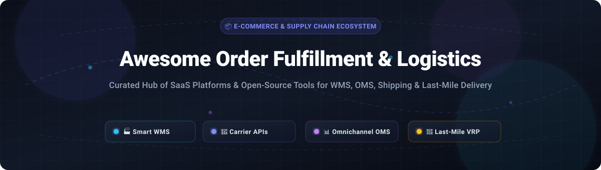

# Awesome Order Fulfillment & Logistics 📦 🚚

  

  
  
  
  
  
  

## 🌐 Top Order Fulfillment & Logistics Tools Ecosystem

> **A curated directory of top-tier SaaS platforms and self-hosted open-source software for Warehouse Management (WMS), Order Management (OMS), Multi-Carrier Shipping Orchestration, and Last-Mile Delivery Optimization.**

📅 **Last updated: March 2026**

This repository tracks notable **SaaS platforms** and **open-source projects** for **Order Fulfillment & Logistics Tools**. Modern commerce requires resilient supply chains: businesses must synchronize multi-warehouse inventory, automate pick-and-pack routing, optimize multi-carrier rate shopping, print automated shipping labels, monitor real-time tracking milestones, and solve complex Vehicle Routing Problems (VRP) for last-mile delivery.

- 🏢 **Enterprise SaaS Leaders**: Scaled commercial solutions including Salesforce Fulfilment Cloud, Manhattan Associates, ShipStation, Flexport, ShipBob, Radial, and ShipHero.
- 🔓 **Self-Hosted & Open-Source Solutions**: Production-ready WMS, headless OMS, and carrier-agnostic API engines empowering brands, 3PL operators, and engineering teams to build sovereign fulfillment stacks with no vendor lock-in.

---

## 📑 Table of Contents

- [📊 Sector Overview & Market Dynamics](#-sector-overview--market-dynamics)
- [☁️ SaaS/Hosted Platforms](#️-saashosted-platforms)
- [💻 Open-Source GitHub Projects](#-open-source-github-projects)
- [🛠️ Frameworks for Custom Fulfillment Stacks](#️-frameworks-for-custom-fulfillment-stacks)
- [🤝 How to Contribute](#-how-to-contribute)
- [📈 Star History](#star-history)
- [💖 Support & Sponsorship](#-support--sponsorship)
- [⚖️ Disclaimer](#️-disclaimer)

---

## 📊 Sector Overview & Market Dynamics

The global order fulfillment and e-commerce logistics market is estimated at approximately **$580B – $710B** (within a broader global logistics and freight ecosystem exceeding **$4.1T – $4.3T**).

The sector exhibits a **bifurcated market structure**:
1. **Moderate Top-Tier Concentration**: The global enterprise parcel and freight infrastructure is anchored by mega-integrators and dominant commerce technology giants (e.g., Salesforce, Manhattan Associates, Auctane).
2. **Structural Mid-Market & Regional Fragmentation**: The operational execution and warehouse software layers remain **structurally fragmented**. Thousands of regional 3PL providers, specialized fulfillment networks, and modern headless open-source stacks thrive alongside enterprise players, ensuring the market does not become a single-winner-take-all monopoly.

---

## ☁️ SaaS/Hosted Platforms

The table below compiles leading commercial platforms sorted by company valuation / scale in descending order:

| Platform | Company Valuation / Scale | Starting Pricing Tier | Free Tier Limit / Free Trial Limit | Description |
| :--- | :--- | :--- | :--- | :--- |
| **[Salesforce Fulfilment Cloud](https://www.salesforce.com/)** | ~$280B+ Market Cap / $34.8B+ Annual Revenue | ~$0.15 – $0.50 per order (billed in pre-purchased blocks of 1,000 Order Summaries) or ~1% GMV | No self-service free trial; interactive guided demo tours and proof-of-concept sandboxes available via enterprise sales | Enterprise order fulfillment platform within Salesforce for orchestrating orders, inventory, and delivery across distributed fulfillment networks. |
| **[Manhattan Associates](https://www.manh.com/)** | ~$13B – $16B Market Cap / $1.0B+ Annual Revenue | ~$150 – $500/user/month (annual enterprise contracts typically starting at $30,000+/year + implementation) | No free trial; live customized product demonstrations and guided feature tours available via sales | Enterprise supply chain commerce platform with warehouse management, order management, and transportation. |
| **[Flexport](https://www.flexport.com/)** | ~$8B Valuation / ~$2B+ Revenue | $5,000/month minimum fulfillment/storage spend (custom freight & per-item fulfillment quotes) | No free software trial; promotional trial periods (e.g. Flexport+ membership trials) offered periodically without free shipping/postage | Digital freight forwarding and supply chain platform with customs, fulfillment, and logistics visibility. |
| **[ShipStation](https://www.shipstation.com/)** | ~$6.6B Valuation (Parent: Auctane / Thoma Bravo) / $230M+ Revenue | $14.99/month (Starter plan, up to 50 shipments/month) | 30-day free trial (up to 30 days full platform access with no carrier discounts excluded; requires user carrier funds or trial label allocation) | Shipping and fulfillment software connecting e-commerce platforms to carriers with label printing, tracking, and automation. |
| **[Deliverr](https://www.deliverr.com/)** | ~$2.1B Acquisition Valuation (Shopify / Flexport) | ~$3.99 – $4.15 per unit fulfillment (all-in pick, pack, and standard delivery for lightweight items < 1 lb) | No free trial; self-service SKU cost calculator available with no monthly software subscription fee | Fulfillment and logistics platform (acquired by Shopify, now integrated with Flexport) with fast shipping programs and inventory distribution. |
| **[ShipBob](https://www.shipbob.com/)** | ~$1.1B – $4.0B Valuation / $97M+ ARR ($1B+ GMV network) | $275/month minimum fulfillment spend; storage from $5/bin/mo, $10/shelf/mo, $40/pallet/mo; picking includes first 4 items free | No free trial; free self-service onboarding available for brands shipping under 400 orders/month (operational fulfillment fees apply) | Third-party logistics (3PL) platform with distributed fulfillment centers, inventory management, and shipping automation for e-commerce. |
| **[Radial](https://www.radial.com/)** | ~$820M Valuation (bpost group) / ~$1B Annual Revenue | Custom transaction rates via Radial Fast Track (no upfront software platform fee; usage-based per unit fulfilled) | No free trial; pay-as-you-go fast-track onboarding with zero upfront license contracts | Omnichannel commerce fulfillment and logistics provider with order management and warehouse operations. |
| **[Quiet Platforms](https://quietplatforms.com/)** | ~$360M Acquisition Valuation (American Eagle Outfitters) | Custom enterprise contract rates (contract logistics and dedicated warehousing rates) | No free trial; zero public trial environments due to physical network and robotics infrastructure | Shared logistics network providing fulfillment and delivery services for retailers and brands. |
| **[ShipHero](https://shiphero.com/)** | ~$225M Valuation / $50M – $80M ARR | $1,850/month (Brand Standard WMS, up to 5 users, unlimited orders/SKUs) | No free trial; 30-day money-back guarantee with live guided onboarding demo | Cloud-based warehouse management and fulfillment platform with inventory, picking, packing, and shipping. |
| **[Deposco](https://www.deposco.com/)** | ~$50M – $100M Valuation / ~$15M – $20M ARR | ~$30,000 – $50,000/year base platform license (approx. $2,500 – $4,166/month equivalent, facility/volume-based) | No free trial; personalized interactive product demos upon consultation request | Cloud-based order management and warehouse execution platform for omnichannel fulfillment. |

---

## 💻 Open-Source GitHub Projects

Curated open-source projects for self-hosted logistics, warehouse execution, and carrier integration, sorted in descending order by GitHub_Stars:

- **[Dolibarr](https://github.com/Dolibarr/dolibarr)**  📦  
  Comprehensive open-source ERP/CRM suite featuring complete inventory management, stock dispatching, warehouse locations, and carrier workflows. Modular architecture allows enabling only fulfillment and shipping components. GPL-3.0 licensed.

- **[GreaterWMS](https://github.com/GreaterWMS/GreaterWMS)**  🏭  
  Open-source warehouse management system designed for enterprise supply chain operations. Features intelligent multi-warehouse inventory allocation, barcode/PDA handheld scanning, automated batch picking, cycle counts, and carrier dispatch. Apache-2.0 licensed.

- **[Fleetbase](https://github.com/fleetbase/fleetbase)**  🚚  
  Modular, API-first logistics operating system and fleet execution platform. Provides routing engines, proof of delivery, driver dispatch management, real-time live GPS tracking, and microservices integration via webhooks. MIT licensed.

- **[ModernWMS](https://github.com/fjykTec/ModernWMS)**  🏢  
  Cross-platform, streamlined warehouse management system built with .NET Core and Vue.js. Provides end-to-end management for receiving, putaway, picking, staging, cycle counting, and order dispatching for SMEs. Apache-2.0 licensed.

- **[openship](https://github.com/openshiporg/openship)**  🌐  
  Open-source multi-channel order fulfillment and shipping orchestration system designed to automate cross-platform e-commerce orders, sync inventory across sales channels, and integrate carrier rate lookups. MIT licensed.

- **[Craftplan](https://github.com/puemos/craftplan)**  📋  
  Open-source manufacturing ERP and fulfillment platform built with Elixir and Phoenix. Features production batch scheduling, lot traceability, raw material inventory allocation, and order fulfillment. Docker-ready and AGPL-3.0 licensed.

- **[OpenBoxes](https://github.com/openboxes/openboxes)**  🏥  
  Battle-tested supply chain and inventory management system designed for healthcare, humanitarian, and enterprise operations. Strengths include lot-level expiration tracking, bin-level stock allocation, purchase orders, and picking route optimization. EPL-1.0 licensed.

- **[karrio](https://github.com/karrioapi/karrio)**  ⚡  
  Universal open-source shipping API and multi-carrier shipping engine (formerly PurplShip). Unifies 100+ parcel carriers (FedEx, UPS, DHL, USPS, Royal Mail) under a single standard REST/GraphQL API for live rates, label printing, tracking, and address validation. Apache-2.0 licensed.

- **[OpenWMS](https://github.com/openwms/org.openwms)**  🏗️  
  Microservice-based warehouse management platform written in Java and Spring Boot. Offers automated warehouse management, transport unit tracking, material flow control, and standardized warehouse topology modeling. Apache-2.0 licensed.

- **[Aiku](https://github.com/Inikoo-Ltd/aiku)**  📲  
  Open-source white-label logistics ERP web application covering warehouse dispatch (bin locations, stock levels, picking paths, packing benches, handheld mobile app), multi-carrier APIs (DPD, GLS, APC, CTT), and 3PL fulfillment. AGPL-3.0 licensed.

- **[openoms](https://github.com/openoms-org/openoms)**  🔌  
  Headless open-source Order Management System for e-commerce featuring 460+ API endpoints and 27 SDK packages. Connects 16+ marketplaces (Amazon SP, eBay, WooCommerce, Allegro) through modular Go SDKs. ELv2 licensed.

- **[Inventoros](https://github.com/Inventoros/Inventoros)**  📊  
  Modern PHP/Laravel inventory and warehouse management system with products, warehouse zones, batch/serial tracking, inbound orders, cycle counts, shipments, and full Sanctum REST API. MIT licensed.

- **[Warehauser](https://github.com/warehauser/warehauser)**  🐍  
  Clean, modular warehouse management backend written in Python and Django. Designed for maintainability with extensible models for bins, product variants, inbound POs, and outbound pick tickets. Apache-2.0 licensed.

- **[better-route](https://github.com/EijunnN/better-route)**  🗺️  
  Self-hosted route optimization and delivery management engine powered by VROOM and OSRM. Solves capacitated vehicle routing problems (CVRP) with real-time WebSocket vehicle updates and a Flutter driver mobile app. Next.js & PostgreSQL stack.

- **[Lynxo](https://github.com/TRADLY-PLATFORM/lynxo)**  📱  
  Open-source mobile and web starter kit for last-mile delivery, hyperlocal parcel commerce, and dispatch logistics. Features offline-first support, React Native/Vite architecture, and headless API connectors.

- **[smart-logistics-vrp](https://github.com/rodrigope12/smart-logistics-vrp)**  🤖  
  Logistics operations platform solving Vehicle Routing Problems (VRP) with time windows and security waypoints using Google OR-Tools. Includes FastAPI backend and an offline-first React Native mobile client.

- **[OpenB2B](https://github.com/deveasyclick/openb2b)**  🤝  
  Multi-tenant B2B wholesale ordering and fulfillment solution with SKU catalog management, PDF commercial invoice generation, customer inventory allotments, and role-based access control. Go/React/PostgreSQL stack.

- **[myWMS](https://www.iml.fraunhofer.de/)** ⚙️  
  Industrial modular open-source warehouse management framework developed by Fraunhofer IML. Provides standardized components and interfaces connecting directly to material flow computers (MFC) and automated automated storage and retrieval systems (ASRS).

---

## 🛠️ Frameworks for Custom Fulfillment Stacks

Architecting an independent, data-sovereign e-commerce logistics platform? Recommended modular combinations:
* **Warehouse Management (WMS)**: [GreaterWMS](https://github.com/GreaterWMS/GreaterWMS), [ModernWMS](https://github.com/fjykTec/ModernWMS), or [OpenBoxes](https://github.com/openboxes/openboxes)
* **Order Orchestration (OMS)**: [openoms](https://github.com/openoms-org/openoms) or [openship](https://github.com/openshiporg/openship)
* **Multi-Carrier Shipping APIs**: [karrio](https://github.com/karrioapi/karrio)
* **Last-Mile & Route Optimization**: [better-route](https://github.com/EijunnN/better-route) (VROOM + OSRM) or [Google OR-Tools](https://developers.google.com/optimization)
* **ERP & Financial Settlement**: [Dolibarr](https://github.com/Dolibarr/dolibarr)

---

## 🤝 How to Contribute

Contributions are warmly welcome! To propose updates or new tools:

1. 🍴 **Fork the repository**.
2. 🌿 **Create a descriptive feature branch** (`git checkout -b add-tool-name`).
3. 📝 **Add or update entries** in `README.md` keeping formatting, links, and factual metrics consistent.
4. 🚀 **Submit a Pull Request** with a brief summary of what was added or updated.

---

##  Star History

---

## 💖 Support & Sponsorship

Thank you for exploring and utilizing **Awesome Order Fulfillment & Logistics**! If this repository has helped streamline your operations, save engineering hours, or guide your supply chain software evaluations, please consider supporting the project:

- ⭐ **Star this repository** to help other engineers, operators, and founders discover it.
- 🍴 **Fork and share** it with your logistics and engineering peers.
- ☕ **Buy a coffee or sponsor ongoing maintenance**: Support via the [GitHub Sponsor Dashboard](https://github.com/sponsors/ishandutta2007).

Your backing fuels ongoing research, verification, and community updates across the open-source supply chain ecosystem! 🙌

---

## ⚖️ Disclaimer

- This repository is a community-curated directory intended solely for educational, analytical, and informational purposes. Mention of specific vendors or projects does not constitute an endorsement.
- Enterprise order fulfillment, logistics integrations, and shipping APIs handle sensitive PII and financial transaction data. Ensure compliance with international data privacy laws (GDPR, CCPA), PCI-DSS standards, and carrier terms of service.
- Self-hosted open-source software deployments require diligent infrastructure hardening, regular backups, encrypted secrets management, and automated vulnerability scanning.
